# Heka Drop

<picture>
  <source media="(prefers-reduced-motion: reduce) and (prefers-color-scheme: dark)" srcset="docs/media/explainer-still-dark.svg">
  <source media="(prefers-reduced-motion: reduce)" srcset="docs/media/explainer-still.svg">
  <source media="(prefers-color-scheme: dark)" srcset="docs/media/explainer-dark.svg">
  
</picture>

[Still version](docs/media/explainer-still.svg) / [Video](docs/media/explainer.mp4)

Hand a secret to a person with a link. An agent takes a value (usually from
[Heka Vault](https://github.com/heka-vault/vault)), encrypts it, and gets back a URL that works a
limited number of times. You paste the URL to a collaborator; they sign in, click Reveal, and the
secret is gone from the server.

**Status:** first slice built: plain drops (no sign-in) from the CLI to the browser. Sign-in,
people, Discord, Vault reads and reverse drops are next. Design:
[ADR 0001](docs/adr/0001-slice-1-plain-drops.md).

## Decided so far

- **End-to-end encrypted.** The sender encrypts before upload. The key rides in the URL `#fragment`,
  which browsers never send, so the server stores only ciphertext.
- **One open and 24 hours by default.** A sender can raise either per drop, up to 10 opens and 7
  days. Ciphertext is deleted on the last open or at expiry.
- **Two kinds of link, chosen per drop.** A plain drop opens for anyone holding the link, with no
  sign-in. A drop marked _sign-in required_ makes the recipient sign in with GitHub or Google first;
  if they have no account yet, that sign-in creates one. Nobody has to sign up before a link can be
  sent to them.
- **Sign-in is Cloudflare Access,** applied only to the sign-in-required paths. The app trusts the
  verified identity Access passes on and has no OAuth code of its own.
- **Addressed drops:** a sign-in-required drop can also name one person, and then only that person
  can open it.
- **Reveal is an explicit click,** so chat link previews cannot use up a drop.
- **Creating drops needs an API token;** only the redeem page faces the internet.
- **A `drop` CLI does the sending.** It reads the value from Heka Vault with the host's own project
  key (or from stdin or a file), encrypts locally, uploads, and prints only the URL. The value stays
  out of the agent's context, and the Drop server holds no vault credentials.
- **Any API token can drop any value it is handed.** Drop does not check which vault project a value
  came from; what a host may read is the vault's concern.
- **Payloads:** text, JSON, and files up to about 1 MB.

## First version also includes

- A Discord message when a drop is opened: who, when, and its label, never the value.
- Listing pending drops and revoking one before it is opened.
- Agents can post the link to Discord for the recipient themselves, as well as hand it back to the
  operator.

## People

Signing in creates a person: the verified GitHub or Google identity, plus metadata such as a display
name and a Discord user id. People exist so that:

- a drop or a reverse-drop request can be addressed to someone by name,
- agents can ping that person in Discord when something is waiting for them,
- the audit log names who opened or submitted what.

A Discord user id gets onto a person in one of two ways:

- **Created from Discord first.** An operator or agent creates the person with a name and Discord
  user id. The id is trusted from the start. The first sign-in through a link addressed to them
  attaches the GitHub or Google identity, and that attachment is announced in Discord so a wrong
  account is noticed.
- **Entered at sign-up.** The person types their own Discord id. It is stored as unverified until
  they confirm it by entering a short code sent to that account in a Discord DM.

Agents can only ping, or address a reverse-drop request to, a person whose Discord id is trusted or
confirmed.

## Reverse drops

A collaborator sometimes has to send a secret back. A reverse drop is a request link that lets them
do that, and it is the one place where an outsider writes into the system, so it is narrow:

- Only a holder of an API token can create a request. There is no open submit page; without a live
  request link there is nothing to post to.
- A request is addressed to one stored person, who must sign in as that identity. It accepts one
  submission, then closes, and it expires like any drop.
- The recipient's browser encrypts to a public key belonging to the host that asked. The server
  stores ciphertext it cannot read.
- Size is capped, and the submission is data only: it is never rendered, parsed, or executed by the
  server or the CLI.
- The requesting agent collects it with the CLI and writes it straight into the vault key named when
  the request was made. The value does not enter the agent's context, and a submission cannot choose
  where it lands.
- Every request, submission, and collection is audited and announced in Discord.

## Using it

Install the CLI once on each sending host (Deno 2):

```sh
git clone https://github.com/heka-vault/drop && cd drop
deno install -g -n drop --allow-net --allow-read --allow-env --config deno.json src/cli.ts
```

Point it at a Drop server and send:

```sh
export DROP_API_URL=https://drop-api.example.com   # the private API
export DROP_PUBLIC_URL=https://drop.example.com    # where recipients open links
export DROP_TOKEN=hdt_...                          # from the server operator
# export DENO_CERT=/path/to/ca.pem                 # only if the API uses a private CA

printf '%s' "$VALUE" | drop send --label "staging db password"
drop send --file ./id_ed25519 --opens 2 --ttl 3600
```

`drop send` prints only the link. Both URLs must be `https://` unless they point at loopback.
`DENO_CERT` adds a CA to the ones Deno already trusts, so a LAN-only API can use a private CA.

The private API, for agents that need more than the CLI:

| Method and path            | What it does                                                                                                                                                                |
| -------------------------- | --------------------------------------------------------------------------------------------------------------------------------------------------------------------------- |
| `POST /api/v1/drops`       | Body: the encrypted blob. Headers: `x-drop-reveal-hash`, optional `x-drop-label`, `x-drop-max-opens` (1–10), `x-drop-ttl` (seconds, ≤ 7 days). Returns `{ id, expiresAt }`. |
| `GET /api/v1/drops`        | This token's pending drops: id, label, opens left, expiry.                                                                                                                  |
| `DELETE /api/v1/drops/:id` | Revoke one of this token's drops.                                                                                                                                           |
| `GET /api/v1/health`       | No token needed.                                                                                                                                                            |

## Development

Deno 2. `deno task test` runs the tests, `deno task check` runs format, lint and type checks, and
`deno task dev` serves the public app on 8090 and the API on 8091, both on loopback.
`test/vectors.py` regenerates the cross-implementation test vectors in `test/vectors.json`.

## Checking what a server runs

The redeem page links to its source code, pinned to the commit the server says it runs. The page's
JavaScript comes from that server, so anyone can compare what it serves with the published files:

```sh
rev=abc1234   # the version shown at the bottom of the redeem page
for f in envelope.js redeem.js; do
  diff <(curl -s "https://drop.example.com/assets/$f") \
    <(curl -s "https://raw.githubusercontent.com/heka-vault/drop/$rev/src/$f") && echo "$f matches"
done
```

This shows what the server sends you right now; it cannot prove what it sends anyone else.

## Hosting your own

One container ([Dockerfile](Dockerfile), example [compose file](deploy/compose.yaml)) and two URLs.
Because the server holds only ciphertext, it can live on a less trusted machine than the secrets it
carries.

1. Run the container with a data directory: `docker compose up -d --build` in `deploy/`.
2. Put HTTPS in front of the **public** port (8090) under a public hostname: a Cloudflare Tunnel,
   Caddy, nginx, or any reverse proxy that does not rewrite pages (see below).
3. Make the **API** port (8091) reachable by your senders and nobody else: loopback if they run on
   the same machine, otherwise a private network with TLS in front. A private CA is fine; senders
   set `DENO_CERT` to it.
4. Create a token per sender: `docker compose run --rm drop create-token --name NAME`.
5. Senders install the CLI and set the three variables above.

What a deployment must get right:

- **Two ports, two audiences.** Port 8090 is the public redeem app: expose only it. Port 8091 is the
  API: never expose it publicly. Keep it on loopback, or on a firewalled private interface behind
  TLS if senders on other hosts call it.
- **Nothing may rewrite or inject scripts on the public hostname.** The page that reads the key is
  served by the server, so anything that adds JavaScript can steal keys. On Cloudflare, keep Rocket
  Loader, Web Analytics / automatic RUM, Zaraz, email obfuscation, and HTML minification off for
  this hostname; on any proxy, do not inject scripts or analytics. The app already sends a strict
  CSP and `Cache-Control: no-store, no-transform`.
- **HTTPS only** on the public hostname (the app sends HSTS).
- **Do not log request bodies** at any proxy. Reveal bodies carry reveal tokens and responses carry
  ciphertext. URL paths hold only drop ids; fragments never reach a server.
- **Data:** one SQLite file (`HEKA_DROP_DB`, default `/data/drop.db`) holding ciphertext, labels,
  token hashes and the audit log. There is no master key. Losing it only loses pending drops.
- **Source link:** set `HEKA_DROP_REVISION` to the deployed commit so the redeem page links to that
  exact code, and `HEKA_DROP_SOURCE_URL` if you run a fork (default: this repository).
- **Environment:** `HEKA_DROP_DB`, `HEKA_DROP_PUBLIC_HOST`/`_PORT` (default `127.0.0.1:8090`),
  `HEKA_DROP_API_HOST`/`_PORT` (default `127.0.0.1:8091`). The image listens on `0.0.0.0` inside the
  container; the compose file binds both ports to the host's loopback.
- **Health:** `GET /api/v1/health` on the API port.
- **Tokens:** `create-token` prints a token once and `revoke-token` revokes it. In Docker, run them
  as `docker compose run --rm drop create-token --name NAME`. Do not keep tokens on the Drop host.
- **HSTS** is sent without `includeSubDomains`; add it at the edge only if every subdomain is HTTPS.

Known limits, by design: the reveal page needs a browser that sends `Sec-Fetch-Site` (all current
ones; Safari before 16.4 is refused rather than let through). Failed reveal attempts are not
audited, so guessing ids cannot flood the log. Deleted ciphertext is overwritten in the database at
once and flushed from the write-ahead log by the minute-by-minute purge.

Cloudflare Workers with Durable Object SQLite storage is a possible later target: storage sits
behind a small port that both fit. It would make keeping the API private a matter of configuration
(Access service tokens, `workers_dev = false`, `preview_urls = false`) rather than a closed port.

## License

[MIT](LICENSE)
